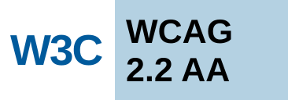

# Заявление о доступности JestBox

**Последняя проверка:** 19 ноября 2026 года  
**Продукт:** JestBox

## Наши обязательства

JestBox стремится быть удобным для людей с разными потребностями в доступности. Работа над доступностью включает постоянное проектирование, разработку и тестирование. В качестве ориентира для проектирования и оценки мы используем WCAG 2.2 уровня AA. Изображение выше является справочной отметкой и не означает, что W3C или WAI проверила, одобрила или сертифицировала JestBox.

## Функции доступности

В разделе «Настройки и суперспособности» можно менять размер текста от 50 % до 200 %, включать повышенную контрастность, уменьшение движения, подчёркивание ссылок, увеличенные области нажатия, дополнительный межстрочный интервал и более заметную клавиатурную рамку фокуса. Настройки сохраняются локально на устройстве. В приложении также доступны десять цветовых тем, семантическая структура страниц, подписанные элементы управления, навигация с клавиатуры, видимый фокус, динамические уведомления, адаптивная компоновка и поддержка системных настроек уменьшения движения и принудительной цветовой схемы.

В списках языка и категории можно искать текст и перемещаться с помощью клавиатуры. Начальный экран закрывается касанием или клавиатурой. Отправка содержимого запускается только пользователем через системный интерфейс платформы.

## Соответствие стандартам и статус тестирования

Перечисленные функции являются реализованными мерами, но не доказывают, что каждый экран и каждая комбинация соответствуют всем критериям WCAG. Мы не заявляем о независимом аудите или сертификации W3C. Использование только клавиатуры, объявления для программ экранного доступа, увеличение текста, перестроение содержимого, контрастность, все темы, шесть языков, диалоговые окна и работа Android требуют практической проверки на разных устройствах и с разными вспомогательными технологиями. Непроверенные или не пройденные критерии необходимо зафиксировать и устранить до заявления о соответствии.

## Известные ограничения

- Интерфейс отправки браузера, операционной системы и принимающего приложения контролируется соответствующей платформой.
- Работа вспомогательных технологий зависит от браузера, операционной системы, устройства и программы экранного доступа.
- Пакет Android и встроенные платформенные компоненты требуют отдельного тестирования доступности на устройствах.

## Как сообщить о проблеме доступности

Укажите экран или элемент управления, шаги для воспроизведения, ожидаемый и фактический результат, устройство, операционную систему, браузер, а также вспомогательную технологию и её версию, если применимо. Не включайте конфиденциальные персональные сведения.

## Контакт по вопросам доступности

- **Имя:** Er. Tapan Jatakia (C. Eng.)
- **Электронная почта:** [cyber.litigation.advisor@gmail.com](mailto:cyber.litigation.advisor@gmail.com)
- **Телефон:** [+91 9664332984](tel:+919664332984)
- **Сайт:** [https://linktr.ee/ertapanjatakia](https://linktr.ee/ertapanjatakia)

## Справочный материал

[W3C — Руководство по обеспечению доступности веб-контента (WCAG) 2.2](https://www.w3.org/TR/WCAG22/)